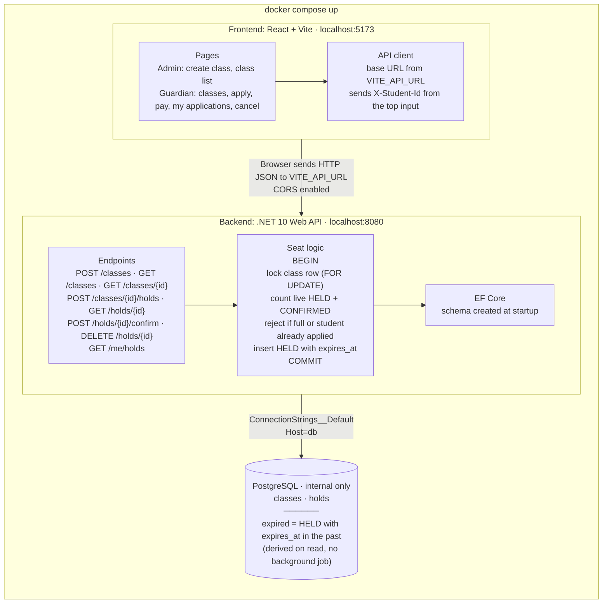
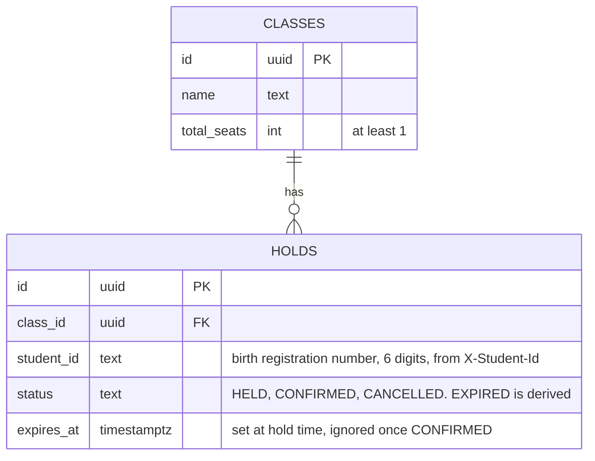

# Admito

School admission system with first-come, first-served seat holding. Guardians apply for a class, a seat is held for a limited time, and paying the admission fee confirms it. Admins create classes and track seats.

## Tech Stack

- Frontend: React + Vite (TypeScript, pnpm)
- Backend: C# .NET 10, EF Core
- Database: PostgreSQL 17
- Docker Compose

## Run

Only Docker is required.

```bash
docker compose up --build
```

| Service  | URL                   |
| -------- | --------------------- |
| Frontend | http://localhost:5173 |
| Backend  | http://localhost:8080 |

The frontend calls the backend at the URL in `VITE_API_URL` (`http://localhost:8080`), set in `docker-compose.yml`. Change it there without touching the source code.

Stop with `Ctrl+C`. Run `docker compose down -v` to also delete the database.

## Configuration

| Variable                     | Service  | Description                  | Default                     |
| ---------------------------- | -------- | ---------------------------- | --------------------------- |
| `ConnectionStrings__Default` | backend  | PostgreSQL connection string | set in `docker-compose.yml` |
| `HOLD_MINUTES`               | backend  | How long a seat is held      | `10`                        |
| `VITE_API_URL`               | frontend | Backend base URL             | `http://localhost:8080`     |

## Architecture



## Database



Indexes: `holds(class_id, status)` for seat counts and `holds(student_id)` for `/me/holds`.

## How It Works

- Applying for a class holds one seat for `HOLD_MINUTES`.
- Paying the admission fee (`Confirm`) within that time confirms the admission.
- After that time the hold is `EXPIRED` and the seat is available again.
- A student can have one live application per class.
- Only a held application can be cancelled. A confirmed admission keeps its seat.

Overbooking is prevented in the database. Each hold runs in one transaction that locks the class row, counts live holds and confirmed seats, and inserts the hold only if a seat is free. Requests for the same class are processed one at a time, in the order they arrive.

Example: a class has 1 seat left and two guardians apply at the same moment. The first to take the row lock gets the seat (`201`). The second sees no seat left (`409`).

## Using the App

- **Guardian:** enter the 6-digit birth registration number (for example `123456`) at the top of the page. Pick a class, apply, pay the fee, or cancel from "My Applications".
- **Admin:** create a class with a name and total seats. The class list shows total, held, confirmed and available seats.

## API

Base URL: `http://localhost:8080`. Endpoints marked with a header need `X-Student-Id: <6-digit number>`.

| Method | Path                       | Header | Success        | Errors        |
| ------ | -------------------------- | ------ | -------------- | ------------- |
| POST   | `/classes`                 | -      | 201 class      | 400           |
| GET    | `/classes`                 | -      | 200 class list | -             |
| GET    | `/classes/{classId}`       | -      | 200 class      | 404           |
| POST   | `/classes/{classId}/holds` | yes    | 201 hold       | 400, 404, 409 |
| GET    | `/holds/{holdId}`          | -      | 200 hold       | 404           |
| POST   | `/holds/{holdId}/confirm`  | yes    | 200 hold       | 400, 404, 409 |
| DELETE | `/holds/{holdId}`          | yes    | 204            | 400, 404, 409 |
| GET    | `/me/holds`                | yes    | 200 hold list  | 400           |

`409` means no seats left, the student already applied to the class, or the hold is no longer in a state that allows the action.

Example:

```bash
curl -X POST http://localhost:8080/classes/<classId>/holds \
  -H "X-Student-Id: 123456"
```

## Tests

Start the stack, then run the tests inside the backend container:

```bash
docker compose up -d
docker compose exec backend dotnet test Tests
```

The tests use their own database, `admito_test`, so your data is not touched.

Tests:

- 1,000 applications sent at the same moment for a class with 100 seats: exactly 100 succeed, the other 900 return `409`.
- 10 simultaneous applications from the same student: exactly one succeeds.
- An expired hold releases its seat.
- A confirmed admission keeps its seat after the hold time has passed.

## Project Structure

```
Admito/
├── backend/
│   ├── Tests/
│   ├── Program.cs
│   └── Dockerfile
├── frontend/
│   ├── src/
│   └── Dockerfile
├── docker-compose.yml
├── ASSUMPTIONS.md
├── AI_USAGE.md
└── README.md
```

## Documents

- [ASSUMPTIONS.md](ASSUMPTIONS.md)
- [AI_USAGE.md](AI_USAGE.md)
